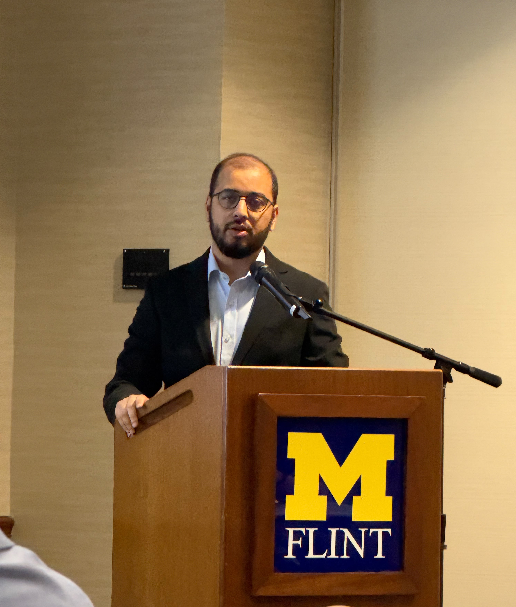
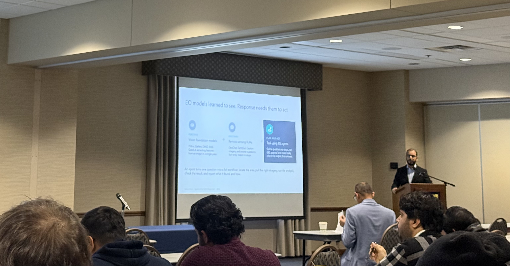

On November 19, the Center for AI and Cybersecurity Seminar at UM-Flint hosted
**Dr. Salman Khan**, Professor of Computer Vision at the Mohamed bin Zayed
University of Artificial Intelligence (MBZUAI) in Abu Dhabi, for *AI for Earth
Observation and Climate Resilience*. The event, also featuring Dr. Lauren E.
Gillespie, combined a keynote with a panel discussion in which students
put questions to the speakers and explored open problems in the field.

## From models that see to agents that act

Earth observation foundation models have learned to interpret satellite
imagery, but responding to what they see takes systems that can act. Dr. Khan
described AI agents that take a single question, locate the area of interest, retrieve the right imagery, run the analysis,
check the result, and report what they found and how.

## About the speaker

Dr. Khan works on computer vision, foundation models and large multimodal
models, with a focus on climate change and Earth observation.

Thanks to Dr. Khan, Dr. Gillespie, and everyone who attended in person and on
Zoom. More photos are in the [gallery](/gallery).
